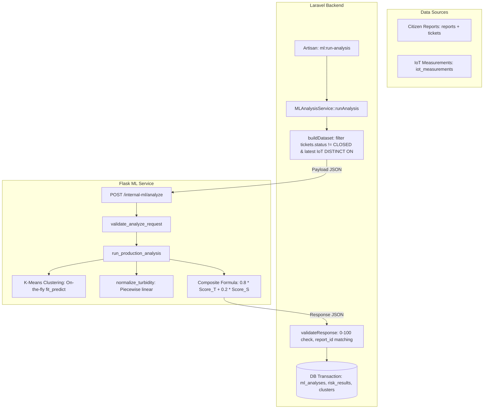

# STEP 4D.61 — AQUA-TARA ML PIPELINE READINESS AUDIT

**Status:** **AUDIT COMPLETED (READ-ONLY)**  
**Tanggal:** 2026-10-12  
**Tujuan Audit:** Pemetaan menyeluruh kesiapan pipeline Machine Learning (ML) AQUA-TARA, pemisahan kapabilitas aktual dari rencana masa depan, identifikasi kebutuhan dataset eksternal, dan peninjauan asumsi teknis sebelum pemilihan dataset/training.  
**Metodologi:** Static code analysis & configuration audit (Read-Only). Tanpa eksekusi training, tanpa instalasi package, tanpa akses Supabase, dan tanpa eksekusi command penulisan database.

---

## 1. Ringkasan Eksekutif

Audit kesiapan ML Pipeline pada **STEP 4D.61** menghasilkan temuan kunci berikut:

1. **Status Implementasi ML Saat Ini:**
   - Pipeline ML saat ini **BUKAN** model supervised machine learning berbasis file model terlatih (`.pkl`, `.joblib`, `.onnx`), melainkan kombinasi dari:
     - **Spatial Clustering On-The-Fly:** Menggunakan `sklearn.cluster.KMeans` yang di-fit secara dinamis saat runtime pada setiap batch laporan warga.
     - **Heuristik Normalisasi Kekeruhan:** Fungsi piecewise-linear deterministik [normalize_turbidity](file:///e:/TUGAS/pengkoding/anti/aqua-tara/ml/app/services/production_analysis.py#L6-L18).
     - **Formula Komposit Risk Score:** Bobot terkunci `round(0.8 * Score_T + 0.2 * Score_S)`, dengan clamp `0–100`.
   - Integrasi jembatan Laravel ↔ Flask telah diimplementasikan secara struktural melalui [MLAnalysisService.php](file:///e:/TUGAS/pengkoding/anti/aqua-tara/backend/app/Services/MLAnalysisService.php) dan Artisan command [RunMLAnalysis.php](file:///e:/TUGAS/pengkoding/anti/aqua-tara/backend/app/Console/Commands/RunMLAnalysis.php).
2. **Ketiadaan Model untuk Fitur Lanjutan:**
   - **Prediksi Kualitas Air Berbasis Dataset Eksternal:** *NOT FOUND* (hanya ada formula piecewise linear 1 fitur turbidity).
   - **Deteksi Anomali IoT Sensor (Flow Rate & Pressure):** *NOT FOUND*. Nilai `flow_rate` dan `pressure` telah diterima oleh endpoint ingestion dan disimpan ke basis data, namun diabaikan sama sekali oleh pipeline ML Flask saat ini.
   - **Derivasi Status IoT (`NORMAL`, `ANOMALY`, `CRITICAL`):** *NOT IMPLEMENTED* (Masih berstatus open architectural decision **F-03**).
3. **Kondisi Tiket Sintetis STEP 4D.60:**
   - Tiket fixture `#55` (dan induknya `Report`) yang dibuat pada STEP 4D.60 terkonfirmasi **masih tersimpan di database lokal `aquatara_test`** (`127.0.0.1:5432`). Laporan STEP 4D.60 mencatat penghentian server, namun tidak mencatat prosedur penghapusan/cleanup data fixture tersebut. Sesuai aturan read-only, data ini dibiarkan apa adanya dan dicatat dalam laporan ini.
4. **Kesiapan Terhadap Dataset Eksternal:**
   - Terdapat **risiko fatal ketidaksesuaian skema (schema mismatch)** jika memaksakan dataset publik umum (misal Kaggle Water Potability) karena sensor fisik AQUA-TARA hanya mengukur 3 parameter (`turbidity`, `flow_rate`, `pressure`), sementara dataset publik mengandalkan parameter kimiawi (`pH`, `Sulfate`, `Chloramines`, dll.) yang tidak ada di perangkat keras.

---

## 2. File dan Fungsi yang Diperiksa

### A. Komponen Python / Flask (`ml/`)
| File | Lokasi Baris | Fungsi / Simbol Kunci | Peran & Catatan Temuan |
|---|---|---|---|
| [ml/requirements.txt](file:///e:/TUGAS/pengkoding/anti/aqua-tara/ml/requirements.txt) | L1–2 | `flask>=3.1.0` | **GAP:** `scikit-learn` dan `numpy` tidak terdaftar, padahal diimpor oleh service produksi. |
| [ml/app/__init__.py](file:///e:/TUGAS/pengkoding/anti/aqua-tara/ml/app/__init__.py) | L18–30 | `create_app()` | Flask Application Factory, mendaftarkan blueprint `analyze_bp`. |
| [ml/app/routes/analyze.py](file:///e:/TUGAS/pengkoding/anti/aqua-tara/ml/app/routes/analyze.py) | L28–90 | `analyze()` | Route internal `POST /internal-ml/analyze`. Memanggil `run_production_analysis`. |
| [ml/app/schemas/analyze.py](file:///e:/TUGAS/pengkoding/anti/aqua-tara/ml/app/schemas/analyze.py) | L16–83 | `validate_analyze_request()` | Memvalidasi array `citizen_reports` dan `iot_data` beserta field numeriknya. |
| [ml/app/services/production_analysis.py](file:///e:/TUGAS/pengkoding/anti/aqua-tara/ml/app/services/production_analysis.py) | L6–19<br>L20–22<br>L23–89 | `normalize_turbidity()`<br>`haversine_distance()`<br>`run_production_analysis()` | Implementasi aktif K-Means dan Risk Score. Menggunakan `0.8 * score_t + 0.2 * score_s`. `haversine_distance` memakai rumus Euclidean derajat. |
| [ml/app/services/mock_analysis.py](file:///e:/TUGAS/pengkoding/anti/aqua-tara/ml/app/services/mock_analysis.py) | L31–115 | `run_mock_analysis()` | Mock analysis tahap awal (fictional formula), sudah tidak dipanggil oleh route aktif. |
| [ml/test_algorithm.py](file:///e:/TUGAS/pengkoding/anti/aqua-tara/ml/test_algorithm.py) | L28–96 | `calculate_risk()`, `normalize_turbidity()` | Skrip prototype awal. **DISCREPANCY:** Menggunakan bobot lama `0.7 * score_t + 0.3 * score_s`. |
| [ml/evaluation/generate_synthetic_data.py](file:///e:/TUGAS/pengkoding/anti/aqua-tara/ml/evaluation/generate_synthetic_data.py) | L18–73<br>L75–155 | `generate_citizen_reports()`<br>`generate_iot_measurements()` | Generator CSV sintetis (41 laporan, 5 node) untuk test boundary K-Means. |
| [ml/evaluation/evaluation_pipeline.py](file:///e:/TUGAS/pengkoding/anti/aqua-tara/ml/evaluation/evaluation_pipeline.py) | L104–145 | `run_pipeline()`, `evaluate_kmeans()` | Pipeline audit dataset sintetis dan kalkulasi `silhouette_score`. |
| [ml/evaluation/evaluation_results.json](file:///e:/TUGAS/pengkoding/anti/aqua-tara/ml/evaluation/evaluation_results.json) | L1–22 | *JSON Artefak* | Mencatat `Silhouette Score: 0.9331` pada data sintetis. |
| [ml/tests/test_production_algorithm.py](file:///e:/TUGAS/pengkoding/anti/aqua-tara/ml/tests/test_production_algorithm.py) | L1–337 | Pytest Suite | 43 skenario unit test untuk `normalize_turbidity`, boundary clamping, K constraints, dll. |

### B. Komponen Backend Laravel (`backend/`)
| File | Lokasi Baris | Fungsi / Simbol Kunci | Peran & Catatan Temuan |
|---|---|---|---|
| [backend/app/Services/MLAnalysisService.php](file:///e:/TUGAS/pengkoding/anti/aqua-tara/backend/app/Services/MLAnalysisService.php) | L24–80<br>L85–146<br>L151–197 | `runAnalysis()`<br>`buildDataset()`<br>`validateResponse()` | Membangun payload dari DB (`tickets.status != CLOSED` dan `DISTINCT ON (node_id)` IoT), memanggil Flask, memvalidasi respons, menyimpan hasil dalam transaksi DB. |
| [backend/app/Console/Commands/RunMLAnalysis.php](file:///e:/TUGAS/pengkoding/anti/aqua-tara/backend/app/Console/Commands/RunMLAnalysis.php) | L19–56 | `handle()` | Artisan CLI command `ml:run-analysis`. Menjalankan `MLAnalysisService`. |
| [backend/app/Models/RiskResult.php](file:///e:/TUGAS/pengkoding/anti/aqua-tara/backend/app/Models/RiskResult.php) | L74–84 | `getRiskLevelAttribute()` | Accessor pemetaan skor: `<=30` = *Jernih*, `<=70` = *Waspada*, `>70` = *Bahaya*. |
| [backend/app/Models/MLAnalysis.php](file:///e:/TUGAS/pengkoding/anti/aqua-tara/backend/app/Models/MLAnalysis.php) | L1–40 | Model `ml_analyses` | Menyimpan log eksekusi analisis (`generated_at`). |
| [backend/app/Models/Cluster.php](file:///e:/TUGAS/pengkoding/anti/aqua-tara/backend/app/Models/Cluster.php) | L1–40 | Model `clusters` | Menyimpan koordinat centroid dan `report_count`. |
| [backend/app/Http/Controllers/IoTIngestController.php](file:///e:/TUGAS/pengkoding/anti/aqua-tara/backend/app/Http/Controllers/IoTIngestController.php) | L15–44 | `store()` | Ingestion endpoint `POST /api/iot/ingest`. Menyimpan raw `turbidity`, `flow_rate`, `pressure`. |
| [backend/tests/Feature/RunMLAnalysisTest.php](file:///e:/TUGAS/pengkoding/anti/aqua-tara/backend/tests/Feature/RunMLAnalysisTest.php) | L15–108 | Feature Test Laravel | Menguji `ml:run-analysis` dengan `Http::fake()`. Menggunakan trait `RefreshDatabase`. |

---

## 3. Arsitektur Alur ML Saat Ini



### Rincian Rantai Eksekusi:
1. **Pemicu:** Artisan CLI `php artisan ml:run-analysis` (atau dijadwalkan via cron/scheduler).
2. **Pengambilan Data (Laravel):**
   - Mengambil laporan warga terbuka (`tickets.status != 'CLOSED'`). Laporan anonim otomatis terambil karena relasi berbasis `report_id`.
   - Mengambil pengukuran IoT terakhir untuk tiap node yang aktif menggunakan kueri SQL `DISTINCT ON (node_id) ... ORDER BY node_id, measured_at DESC`.
3. **Komunikasi Lintas Service:**
   - Dikirim melalui HTTP POST internal ke `http://127.0.0.1:5000/internal-ml/analyze` dengan timeout 10 detik.
4. **Pemrosesan (Flask):**
   - Validasi skema memastikan kelengkapan koordinat dan field numerik.
   - Eksekusi K-Means terhadap koordinat `[latitude, longitude]`.
   - Normalisasi kekeruhan dari node terdekat.
   - Kalkulasi Risk Score per laporan.
5. **Persistensi (Laravel):**
   - Transaksi database menulis record baru ke tabel `ml_analyses`, `risk_results`, dan `clusters`.
   - Catatan: Hubungan cluster terhadap laporan warga **bersifat transien (tidak persisten)** sesuai *DEC-002 / DEC-017*; kolom `cluster_id` tidak disimpan di tabel laporan.

---

## 4. Status Setiap Komponen ML

| Komponen ML | Status Aktual | Detail Implementasi & Bukti Sumber |
|---|---|---|
| **Spatial K-Means Clustering** | **IMPLEMENTED** | Menggunakan `sklearn.cluster.KMeans` di [production_analysis.py:53](file:///e:/TUGAS/pengkoding/anti/aqua-tara/ml/app/services/production_analysis.py#L53). Di-fit on-the-fly per request batch. Bukan model offline pre-trained. |
| **K-Strategy (Dynamic K)** | **IMPLEMENTED** | Formula: `K = max(1, min(5, N // 5))`. Menangani edge cases: `N=0` (empty return), `N<5` (`K=1`), koordinat identik (`np.all(coords == coords[0]) -> K=1`). |
| **Turbidity Normalization (`Score_T`)** | **IMPLEMENTED** | Formula piecewise linear deterministik di [production_analysis.py:6-18](file:///e:/TUGAS/pengkoding/anti/aqua-tara/ml/app/services/production_analysis.py#L6-L18). Memetakan 0–50 NTU ke 0–100 poin. Clamp negatif ke 0. Fallback NaN/None ke 30.0. |
| **Spatial Density Score (`Score_S`)** | **IMPLEMENTED** | Formula deterministik di [production_analysis.py:73](file:///e:/TUGAS/pengkoding/anti/aqua-tara/ml/app/services/production_analysis.py#L73): `score_s = min(100.0, cluster_count * 15.0)`. |
| **Composite Risk Score Formula** | **IMPLEMENTED** | Formula: `round(0.8 * score_t + 0.2 * score_s)`, diclamp ke rentang integer 0–100 di [production_analysis.py:81-82](file:///e:/TUGAS/pengkoding/anti/aqua-tara/ml/app/services/production_analysis.py#L81-L82). |
| **Kategorisasi Level Risiko** | **IMPLEMENTED** | Accessor `RiskResult::getRiskLevelAttribute()` di [RiskResult.php:74-84](file:///e:/TUGAS/pengkoding/anti/aqua-tara/backend/app/Models/RiskResult.php#L74-L84): `0–30` (*Jernih*), `31–70` (*Waspada*), `71–100` (*Bahaya*). |
| **Flask API & Schema Guard** | **IMPLEMENTED** | Blueprint `POST /internal-ml/analyze` di [analyze.py](file:///e:/TUGAS/pengkoding/anti/aqua-tara/ml/app/routes/analyze.py) dan validator di [schemas/analyze.py](file:///e:/TUGAS/pengkoding/anti/aqua-tara/ml/app/schemas/analyze.py). |
| **Laravel Orchestrator Service** | **IMPLEMENTED** | [MLAnalysisService.php](file:///e:/TUGAS/pengkoding/anti/aqua-tara/backend/app/Services/MLAnalysisService.php) dan command [RunMLAnalysis.php](file:///e:/TUGAS/pengkoding/anti/aqua-tara/backend/app/Console/Commands/RunMLAnalysis.php). |
| **Evaluasi Pipeline Sintetis** | **PARTIAL** | Terdapat di [evaluation_pipeline.py](file:///e:/TUGAS/pengkoding/anti/aqua-tara/ml/evaluation/evaluation_pipeline.py), namun hanya mengevaluasi file CSV sintetis oracle test, bukan evaluasi performa model prediktif. |
| **Prediksi Kualitas Air Multivariat** | **NOT FOUND** | Tidak ada model supervised learning (misal Random Forest, XGBoost, MLP) untuk klasifikasi/regresi kualitas air. |
| **Deteksi Anomali IoT Time-Series** | **NOT FOUND** | Tidak ada algoritma anomali (misal Isolation Forest, Autoencoder, Z-Score windowing) pada `flow_rate` atau `pressure`. |
| **Derivasi Status IoT (`NORMAL/ANOMALY/CRITICAL`)** | **NOT FOUND** | Open Decision **F-03**. Tidak ada threshold atau logika komputasi di backend untuk menentukan status operasional node. |
| **Model Persistence / Artifact Loading** | **NOT FOUND** | Tidak ada pemuatan model dari disk (`joblib.load()`, `pickle.load()`). Seluruh logika bersifat heuristik atau fit-at-runtime. |

---

## 5. Kebutuhan Dataset per Komponen

Audit memetakan kebutuhan dataset eksternal untuk 3 komponen utama proyek:

### 1. Prediksi Kualitas Air (Water Quality / Potability Prediction)
- **Kondisi Saat Ini:** Hanya mengandalkan formula normalisasi 1 parameter kekeruhan (`turbidity`).
- **Apakah Membutuhkan Dataset Eksternal?** **YA, HANYA JIKA** ruang lingkup proyek ditingkatkan menjadi model klasifikasi kelayakan air (*water potability*) atau prediksi indeks kualitas air multi-parameter.
- **Kebutuhan Fitur:** Dataset eksternal publik (seperti *Kaggle Water Potability Dataset*) biasanya memuat 9–10 fitur kimia: `pH`, `Hardness`, `Solids`, `Chloramines`, `Sulfate`, `Conductivity`, `Organic_carbon`, `Trihalomethanes`, `Turbidity`.
- **CRITICAL MISMATCH:** Hardware IoT AQUA-TARA **hanya mengukur 1 parameter kualitas air yaitu `turbidity`**. Sensor fisik tidak memiliki sensor kimia pH, sulfat, kloramin, dll. Melatih model ML menggunakan dataset eksternal multi-kimiawi akan menyebabkan model **tidak dapat digunakan saat inferensi (unusable in production)** karena fitur-fitur tersebut *missing* pada data operasional.

### 2. Deteksi Anomali Sensor Time-Series (Flow Rate & Pressure Anomaly)
- **Kondisi Saat Ini:** Raw data `flow_rate` dan `pressure` di-ingest ke `iot_measurements`, tetapi diabaikan oleh Flask ML. Status IoT `NORMAL / ANOMALY / CRITICAL` belum memiliki formula penurunan.
- **Apakah Membutuhkan Dataset Eksternal?** **YA**, jika deteksi kebocoran pipa atau anomali tekanan akan menggunakan model ML (misal Unsupervised Anomaly Detection / Isolation Forest / LSTM-Autoencoder).
- **Kebutuhan Fitur:**
  - Time-series hidrolik jaringan pipa distribusi air (Water Distribution Network / WDN).
  - Kolom: `timestamp`, `flow_rate` (L/min, m³/jam), `pressure` (bar, psi), `turbidity` (NTU), dan label kejadian (`anomaly_flag` / `leak_event`).
  - Contoh dataset benchmark ilmiah: *BATADAL (Battle of the Attack-Detection Algorithms)* atau *LeakDB*.

### 3. Clustering Lokasi (Latitude / Longitude)
- **Kondisi Saat Ini:** K-Means berjalan secara *unsupervised* dan di-fit langsung saat runtime terhadap koordinat laporan aktif.
- **Apakah Membutuhkan Dataset Eksternal untuk Training?** **TIDAK**.
  - Algoritma unsupervised clustering tidak memerlukan fase training berlabel (*no labeled dataset required*). Model mempelajari struktur spasial langsung dari data incoming laporan warga.
  - Data eksternal geospasial (misalnya batas batas administratif/koordinat jaringan pipa PDAM lokal) hanya dibutuhkan sebagai konteks geografis (geofencing) atau kalibrasi metrik jarak, bukan untuk *weight training*.

---

## 6. Gap dan Risiko Teknis

### A. Risiko Ketergantungan Paket (`requirements.txt`)
- [ml/requirements.txt](file:///e:/TUGAS/pengkoding/anti/aqua-tara/ml/requirements.txt) hanya berisi `flask>=3.1.0`.
- [ml/app/services/production_analysis.py](file:///e:/TUGAS/pengkoding/anti/aqua-tara/ml/app/services/production_analysis.py) mengimpor `from sklearn.cluster import KMeans` dan `import numpy as np`.
- **Risiko:** Jika environment Python di-deploy atau diinstal ulang berdasarkan `requirements.txt`, service Flask akan langsung mengalami fatal error `ModuleNotFoundError: No module named 'sklearn'`.

### B. Inkonsistensi Bobot Risk Score Antar Berkas
- [ml/test_algorithm.py:88](file:///e:/TUGAS/pengkoding/anti/aqua-tara/ml/test_algorithm.py#L88) menggunakan bobot prototipe lama: `0.7 * score_t + 0.3 * score_s`.
- [ml/app/services/production_analysis.py:81](file:///e:/TUGAS/pengkoding/anti/aqua-tara/ml/app/services/production_analysis.py#L81) menggunakan bobot kanonikal yang disepakati: `0.8 * score_t + 0.2 * score_s`.
- **Risiko:** Kebingungan developer saat membaca file prototipe vs file produksi. `test_algorithm.py` harus diberi tanda jelas sebagai berkas prototipe usang.

### C. Metrik Jarak Spasial (Euclidean vs Haversine)
- Fungsi di [production_analysis.py:20](file:///e:/TUGAS/pengkoding/anti/aqua-tara/ml/app/services/production_analysis.py#L20) diberi nama `haversine_distance`, namun implementasinya adalah jarak planar Euclidean pada derajat koordinat:
  ```python
  math.sqrt((lat1 - lat2)**2 + (lon1 - lon2)**2)
  ```
- **Risiko:** 1 derajat latitude tidak identik dengan 1 derajat longitude di wilayah tropis / non-ekuator, dan distorsi derajat dapat mendistorsi jarak terdekat ke IoT node jika jarak spasial cukup renggang.

### D. Fitur Terabaikan pada Sensor IoT
- Ingestion endpoint menerima `flow_rate` dan `pressure`, tetapi `production_analysis.py` hanya membaca `turbidity`.
- Terjadi disparitas fungsional antara data yang dikumpulkan dari perangkat keras dengan parameter yang benar-benar diproses oleh mesin ML.

### E. Ketiadaan Serialisasi Model (Artifactless Pipeline)
- Seluruh pipeline ML saat ini bersifat komputasi fungsional langsung (*stateless*).
- Jika di masa mendatang diterapkan model terlatih eksternal, ketiadaan mekanisme manajemen versi model (MLOps pipeline / model registry / artifact store) akan menimbulkan risiko inkonsistensi preprocessing antara training script dan inference API.

### F. Status Fixture Tiket STEP 4D.60
- Tiket `#55` dan data `Report` terkait masih tertinggal di database pengujian lokal `aquatara_test` (`127.0.0.1:5432`). Laporan STEP 4D.60 tidak mencakup tahap teardown fixture. Meskipun tidak mengganggu isolasi Supabase, keberadaan fixture ini berpotensi terbawa ke dalam kueri `buildDataset()` jika command `ml:run-analysis` dieksekusi di lingkungan pengujian tanpa filter transaksi.

---

## 7. Keputusan yang Masih Diperlukan (Open Decisions)

1. **Keputusan F-03 (Derivasi Status IoT):**
   - Belum ada aturan bisnis atau model untuk memetakan `turbidity`, `flow_rate`, dan `pressure` ke status `NORMAL`, `ANOMALY`, atau `CRITICAL` untuk API peta publik.
   - *Pilihan Solusi:* Apakah akan menggunakan aturan thresholding statistik sederhana (misal batasan ambang batas WHO/Permenkes untuk kekeruhan dan rentang tekanan pipa normal), atau model deteksi anomali ML time-series?
2. **Definisi Masalah untuk Supervised ML:**
   - Sebelum mencari dataset eksternal, pemangku kepentingan harus menetapkan: *Masalah apa yang ingin diselesaikan dengan training dataset eksternal?*
     - Jika tujuannya memprediksi kualitas air umum, hardware IoT saat ini tidak memiliki sensor kimia yang memadai.
     - Jika tujuannya mendeteksi kebocoran pipa (*pipe leak detection*), diperlukan dataset hidrolik jaringan pipa air yang memiliki parameter debit dan tekanan.
3. **Penyempurnaan Metrik Jarak Spasial:**
   - Menentukan apakah implementasi `haversine_distance` perlu diperbarui ke rumus Haversine bola bumi sejati (menghasilkan meter/kilometer) sebelum melangkah ke pengujian akurasi spasial.

---

## 8. Rekomendasi Urutan STEP 4D.62 dan Seterusnya

Untuk menjaga stabilitas arsitektur dan menghindari training sia-sia pada dataset yang tidak kompatibel, berikut rekomendasi tahapan selanjutnya:

```
STEP 4D.61 (Current) ──> STEP 4D.62: Sinkronisasi Dependensi & Pembersihan Prototipe
                     ──> STEP 4D.63: Penyelesaian Keputusan F-03 (IoT Status & Sensor Utilization)
                     ──> STEP 4D.64: Evaluasi Kecukupan Dataset & Pemilihan Target Model
                     ──> STEP 4E: Training / Kalibrasi Pipeline Terpilih
```

1. **STEP 4D.62 (Rekomendasi Pertama):**
   - Perbarui `ml/requirements.txt` agar mencakup `scikit-learn` dan `numpy`.
   - Tandai atau sinkronkan bobot `test_algorithm.py` agar tidak menimbulkan ambigu.
   - Dokumentasikan prosedur pembersihan fixture test DB.
2. **STEP 4D.63 (Rekomendasi Kedua):**
   - Tetapkan definisi atau formula ambang batas untuk Decision **F-03** (`NORMAL`, `ANOMALY`, `CRITICAL`) sehingga data `flow_rate` dan `pressure` dapat dimanfaatkan secara produktif.
3. **STEP 4D.64 (Rekomendasi Ketiga):**
   - Tentukan secara spesifik target model ML yang akan dilatih. Jangan mengunduh atau melatih dataset publik sebelum skema fitur sensor hardware diverifikasi cocok 1:1 dengan fitur dataset.

---

## 9. Daftar Blocker Sebelum Training Dataset Eksternal

| No | Blocker | Alasan Teknis | Tindakan Penyelesaian yang Wajib Dilakukan |
|---|---|---|---|
| **B-1** | **Feature Schema Mismatch** | Dataset kualitas air publik (misal Kaggle Water Potability) membutuhkan parameter kimia (`pH`, `Sulfate`, `Chloramines`, dll.) yang **tidak ada** di sensor IoT AQUA-TARA. Training pada dataset tersebut akan menghasilkan model yang *useless* saat di-deploy. | Batasi pencarian dataset hanya pada dataset yang memiliki parameter kompatibel: `turbidity` tunggal, atau dataset hidrolik pipa (`flow_rate` + `pressure`). |
| **B-2** | **Open Decision F-03 (IoT Status)** | Status `NORMAL/ANOMALY/CRITICAL` belum memiliki formula/label ground truth di sistem. | Tetapkan ambang batas matematis/operasional atau target label sebelum melatih model anomali. |
| **B-3** | **Dependensi Python Belum Lengkap** | `ml/requirements.txt` belum mendeklarasikan `scikit-learn` dan `numpy`. | Deklarasikan dependensi resmi di `requirements.txt` untuk memastikan lingkungan eksekusi training konsisten. |
| **B-4** | **K-Means Bersifat Unsupervised** | Spatial clustering yang ada saat ini tidak membutuhkan training dataset eksternal karena berjalan langsung pada data laporan warga saat runtime. | Jangan membuang waktu mencoba melakukan supervised training untuk K-Means spasial; cukup lakukan tuning K atau evaluasi metrik jarak jika diperlukan. |
