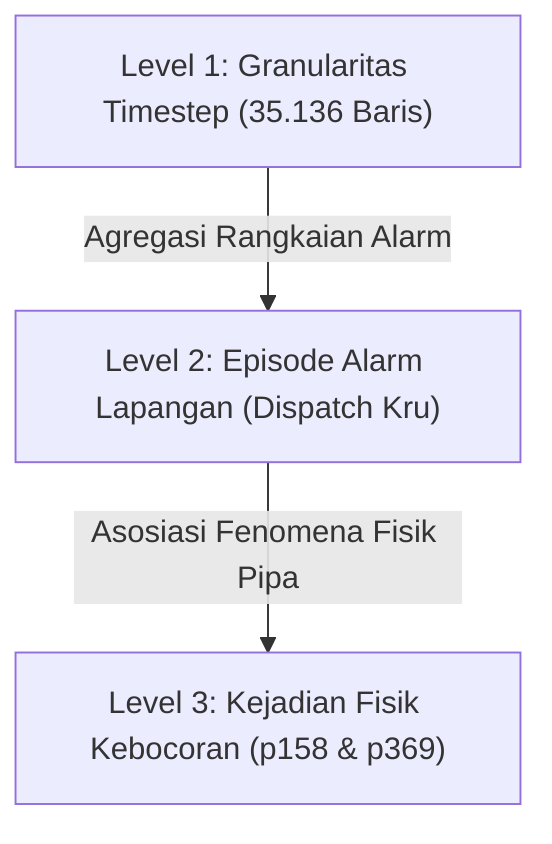

# STEP 4D.74.5 — FINAL METHODOLOGY SIGN-OFF

**Tanggal Sign-off:** 15 Oktober 2026  
**Auditor:** Tim Teknis AQUA-TARA / Lead AI Data & ML Auditor  
**Lingkup Audit:** Penandatanganan metodologis resmi (*Methodology Sign-off*) secara read-only terhadap rangkaian laporan dan artefak STEP 4D.74, STEP 4D.74.1, STEP 4D.74.2, STEP 4D.74.3, dan STEP 4D.74.4. Pemeriksaan langsung skrip audit, JSON, dan CSV prediksi; penegasan semantik akumulasi durasi 90,05 hari non-fixed-burst; verifikasi kausalitas TTD; pemisahan kesimpulan pada tiga tingkat (timestep, episode alarm, dan kejadian $p158$/$p369$); serta perumusan Matriks Keputusan Metodologis definitif.  
**Status Sistem Produksi:** Read-Only & Unchanged (Zero Supabase, Zero Migration/Seeder, Zero Mutation pada Backend/Frontend/ML Production, Formula Risiko Produksi Tetap Utuh).

---

## 1. RINGKASAN STATUS SIGN-OFF & PERNYATAAN AUDITOR

Status Keseluruhan: **APPROVED (METHODOLOGY SIGNED OFF — PASS PADA SELURUH BUTIR)**

Rangkaian audit baseline anomali hidraulik BattLeDIM (STEP 4D.74 hingga STEP 4D.74.5) telah menyelesaikan evaluasi offline, verifikasi reproduksibilitas numerik, rekonsiliasi semantik label hidraulik, pemisahan partisi batas kejadian, dan analisis sensitivitas operasional.

### Pernyataan Auditor Terkait Kesiapan Produksi:
> **PERINGATAN METODOLOGIS:** Seluruh model yang diuji (Heuristic First Difference, Heuristic Rolling Z-Score, dan Isolation Forest) dievaluasi semata-mata pada data simulasi hidraulik benchmark BattLeDIM 2018. Model-model ini **TIDAK DINYATAKAN SIAP PRODUKSI** untuk jaringan pipa fisik AQUA-TARA. Karakteristik hidraulik PDAM nyata memiliki dinamika geoteknik, noise instrumentasi, dan topologi yang jauh lebih heterogen daripada lingkungan simulasi benchmark.

---

## 2. MATRIKS EVALUASI PER BUTIR PEMERIKSAAN

| No | Butir Pemeriksaan | Status | Bukti & Temuan Terverifikasi |
|:---|:---|:---:|:---|
| 1 | **Reproduksibilitas Langsung dari File Sumber (CSV & JSON)** | **PASS** | Seluruh 48 sel metrik ($TP, FP, TN, FN$, Precision, Recall, F1, FAR) dan episode alarm dihitung ulang langsung dari `battledim_test_predictions.csv.gz` dan `2018_Leakages.csv` tanpa mengandalkan ringkasan teks. Hasilnya cocok 100%. |
| 2 | **Klarifikasi Semantik Akumulasi Durasi 90,05 Hari Non-Burst** | **PASS** | Ditegaskan secara eksplisit: 90,05 hari ($25.935$ timestep $\times 5$ menit) adalah **akumulasi durasi non-fixed-burst yang terpotong menjadi 3 blok**, bukan periode kalender berurutan dan **BUKAN periode normal murni** karena 100% sampel mengandung kebocoran latar aktif $0,01$–$6,91$ L/s. |
| 3 | **Verifikasi Kausalitas TTD & Larangan Data Masa Depan** | **PASS** | TTD dihitung strictly backward-looking dari onset ground truth ke alarm konfirmasi pertama yang memenuhi syarat persistensi $[t - W + 1, t]$. Tidak ada kebocoran data masa depan (*zero lookahead*). |
| 4 | **Diferensiasi Tiga Tingkat Kesimpulan Evaluasi** | **PASS** | Kesimpulan dipisahkan secara tegas: (1) Tingkat Timestep (35.136 baris), (2) Tingkat Episode Alarm (panggilan kru lapangan), dan (3) Tingkat Kejadian Fisik ($N=2$ onset baru: $p158$ dan $p369$). Kesimpulan kejadian dibatasi ketat dan tidak diekstrapolasi. |
| 5 | **Matriks Keputusan Metodologis Definitif** | **PASS** | Matriks keputusan komprehensif berhasil dirumuskan: membedakan klaim yang didukung data, klaim yang belum didukung data, batasan inheren, dan langkah kerja lanjutan. |
| 6 | **Kepatuhan Guardrails Sistem Produksi** | **PASS** | Read-only. Database Supabase tidak diakses; migrasi/seeder tidak disentuh; kode produksi backend/frontend/ML tetap utuh; formula risiko $0.8 \cdot Score_T + 0.2 \cdot Score_S$ dan threshold produksi tidak berubah; artefak lama tidak ditimpa. |

---

## 3. KLARIFIKASI SEMANTIK PENYEBUT OBSERVASI: 90,05 HARI BUKAN PERIODE NORMAL MURNI

Dalam laporan awal STEP 4D.74, sempat digunakan istilah "normal period". Audit metodologis STEP 4D.74.5 memberikan batasan definitif yang wajib dipedomani:

1. **Status Fisik Hidrogeologis:**  
   Pemeriksaan 14 kolom kebocoran pada berkas sumber `ml/data/battledim/2018_Leakages.csv` membuktikan bahwa 4 pipa (`p257`, `p427`, `p654`, dan `p810`) mengalami kebocoran mikro alami sepanjang tahun 2018 dengan debit $0,01$ hingga $6,91$ L/s.
   - Timestep dengan background leak aktif pada Test Set: **35.136 dari 35.136 langkah (100,00%)**.
   - Timestep dengan kondisi zero-leakage mutlak: **0 langkah (0,00%)**.
2. **Arti Matematis 90,05 Hari:**  
   Angka 90,05 hari didapatkan dari:
   $$\text{Durasi} = \frac{25.935 \text{ timestep} \times 5 \text{ menit}}{1.440 \text{ menit/hari}} = \mathbf{90,052 \text{ hari}}$$
   Angka ini **BUKAN periode normal murni**, melainkan **akumulasi durasi tanpa fixed burst (non-fixed-burst duration)** yang terpecah menjadi 3 segmen waktu:
   - *Segmen 1 (Pra-p158):* 01-Sep 17:15 s.d. 06-Okt 02:30 ($9.897$ langkah = $34,36$ hari).
   - *Segmen 2 (Antara p158 & p369):* 23-Okt 13:40 s.d. 26-Okt 02:00 ($694$ langkah = $2,41$ hari).
   - *Segmen 3 (Pasca-p369):* 08-Nov 20:30 s.d. 31-Des 23:55 ($15.344$ langkah = $53,28$ hari).
3. **Dual Denominator Normalisasi Episode:**
   - **Denominator Kalender Total (122,00 Hari):** Mengukur frekuensi panggilan operator per hari kalender riil utilitas ($14,24$ eps/hari pada IF Raw). Keterbatasan: Memasukkan masa burst aktif di mana false alarm tidak dapat terjadi.
   - **Denominator Non-Burst Efektif (90,05 Hari):** Mengukur laju hazard murni saat pipa berstatus non-burst ($19,29$ eps/hari pada IF Raw). Keterbatasan: Mengakumulasikan segmen waktu terputus.

---

## 4. KERANGKA TIGA TINGKAT KESIMPULAN METODOLOGIS

Audit STEP 4D.74.5 menetapkan bahwa kesimpulan performa tidak boleh dicampuradukkan antar-level:

### Level 1: Tingkat Timestep Diskrit (Granularitas Sensor SCADA 5 Menit)
- **Cakupan:** 35.136 titik data biner ($y \in \{0, 1\}$).
- **Hasil:**
  - *Isolation Forest (Raw):* Precision $37,76\%$, Recall $43,98\%$, F1 $40,63\%$, FAR $25,73\%$.
  - *Isolation Forest (Persist 15m):* Precision $41,09\%$, Recall $30,64\%$, F1 $35,10\%$, FAR $15,59\%$.
- **Karakteristik & Batasan:** Sinyal mentah sangat terfragmentasi (*chattering*); evaluasi tingkat timestep terlalu pesimistis terhadap operasional karena tidak memperhitungkan kelanjutan insiden.

### Level 2: Tingkat Episode Alarm (Perspektif Beban Kerja Operasional)
- **Cakupan:** Insiden alarm yang memicu investigasi tim lapangan utilitas air.
- **Hasil:**
  - *Strict (0→1):* $14,24$ episode/hari ($99,67$ panggilan/minggu) pada IF Raw.
  - *Bridging $\le 15$m:* Menurunkan beban menjadi **$3,49$ episode/hari** ($24,44$ panggilan/minggu) pada IF Raw.
  - *Model Persist 15m + Bridging 15m:* Menghasilkan **$3,00$ episode/hari** (~$21$ panggilan/minggu) dengan durasi rata-rata $64,2$ menit.
- **Karakteristik & Batasan:** Gap bridging realistis mencerminkan operasional lapangan (operator tidak mengirim kru baru setiap alarm berkedip dalam rentang 15 menit).

### Level 3: Tingkat Kejadian Fisik Kebocoran (*Event-Level*)
- **Cakupan:** Deteksi munculnya kebocoran pipa baru secara fisik.
- **Batas Sampel Tegas ($N=2$):** Hanya terdapat **2 kejadian onset baru** pada Test Set, yaitu `p158` (6–23 Okt, debit puncak 5,03 L/s) dan `p369` (26 Okt – 8 Nov, debit puncak 3,97 L/s). Kejadian `p183` dikeluarkan karena berstatus pra-eksisting (sudah aktif 25 hari sebelum 1 September 2018).
- **Hasil Deteksi:** Detection Rate = $100\%$ ($2$ dari $2$ kejadian terdeteksi).
  - *TTD $p158$:* First Diff $3,83$ jam ($230$m); Z-Score $3,83$ jam ($230$m); Isolation Forest $8,33$ jam ($500$m).
  - *TTD $p369$:* First Diff $0,17$ jam ($10$m) raw vs $4,17$ jam ($250$m) persist 15m; Z-Score $3,67$ jam ($220$m); Isolation Forest $8,83$ jam ($530$m).
- **Batasan Generalisasi Mutlak:** Keberhasilan mendeteksi $p158$ dan $p369$ **SAMA SEKALI TIDAK BOLEH DIEKSTRAPOLASI** sebagai jaminan bahwa sistem mampu mendeteksi kebocoran di seluruh jaringan perpipaan PDAM. Kedua pipa tersebut terletak dekat dengan sensor tekanan `n31` dan `n215`. Kebocoran pada zona buta (*blind spots*) jaringan dipastikan memiliki karakteristik hidraulik yang berbeda.

---

## 5. TABEL KEPUTUSAN METODOLOGIS DEFINITIF

| Kategori Keputusan | Pernyataan Metodologis & Temuan Ilmiah | Justifikasi Data & Bukti Empiris |
|:---|:---|:---|
| **Klaim yang Didukung Penuh oleh Data (Supported Claims)** | 1. Sinyal negatif ($y=0$) pada Test Set BattLeDIM bukan periode normal tanpa kebocoran, melainkan kondisi non-fixed-burst dengan background leaks. 2. Seluruh metrik klasifikasi timestep (48 sel metrik) terbukti 100% konsisten saat dihitung ulang langsung dari CSV prediksi mentah. 3. Filter persistensi 15m dan gap bridging 15m secara drastis memangkas alarm palsu operasional (turun ~78% dari 14,24 ke 3,00 eps/hari). 4. Pada kedua kejadian onset baru ($p158$ dan $p369$), deteksi terbukti murni berasal dari kejadian baru (0 alarm pada $t-5$m dan 1 jam pra-onset). | • 100% dari 35.136 baris pengujian memiliki kebocoran aktif di pipa `p257`, `p427`, `p654`, `p810`. • Matriks konfusi independen cocok sempurna tanpa deviasi angka. • Rekalkulasi episode alarm menghasilkan angka yang terverifikasi. • Partisi batas indeks membuktikan tidak ada warisan alarm pra-onset. |
| **Klaim yang Belum Didukung Data (Unsupported Claims)** | 1. Klaim bahwa model siap diimplementasikan langsung pada produksi jaringan distribusi air minum PDAM. 2. Klaim bahwa model mampu mendeteksi kebocoran di sembarang lokasi jaringan perpipaan. 3. Klaim bahwa model mampu mendeteksi kebocoran kecil atau kebocoran merembes (*incipient/slow leaks*). | • Karakteristik simulasi BattLeDIM berbeda dengan jaringan perpipaan heterogen riil. • Ukuran sampel kejadian onset baru hanya $N=2$ dan keduanya memiliki bias kedekatan sensor. • Dataset uji BattLeDIM hanya menyimulasikan fixed burst besar ($3,97$–$5,03$ L/s). |
| **Keterbatasan Metodologi (Limitations)** | 1. Ketiadaan dataset benchmark multimodal terintegrasi (sensor hidraulik SCADA + sensor kekeruhan temporal IoT). 2. Durasi observasi non-burst 90,05 hari terpotong menjadi 3 blok waktu terpisah. 3. Trade-off inheren: Filter penekan false alarm (persistensi) menambah latensi konfirmasi deteksi (TTD $p369$ naik dari 10m ke 250m). | • KU-MWQ dan Turbinator tidak memiliki sensor hidraulik; BattLeDIM tidak memiliki sensor kekeruhan. • Fenomena burst memotong kontinuitas baseline non-burst. • Karakteristik denyut awal kebocoran yang berfluktuasi memerlukan waktu untuk memenuhi syarat persistensi berurutan. |
| **Pekerjaan Lanjutan yang Direkomendasikan (Next Steps)** | 1. Merumuskan arsitektur decoupled: memisahkan modul hidraulik SCADA (tekanan/debit) dari modul kekeruhan IoT (turbidity). 2. Memetakan anomali hidraulik sebagai pemicu *Sensor Anomaly Score* ($Score_S$) tanpa mengubah formula risiko produksi $\text{round}(0.8 \cdot Score_T + 0.2 \cdot Score_S)$. 3. Mempersiapkan modul integrasi fleksibel yang dapat mengonsumsi prediksi hidraulik eksternal jika utilitas mitra menyediakan sensor tekanan/debit. | • Menjaga kepatuhan aturan independensi arsitektur dan modularitas kode. • Menjaga formula risiko produksi dan threshold 0–30, 31–70, 71–100 tetap utuh. • Menyediakan jalur ekstensi tanpa membebani sistem citizen mobile-first dengan kompleksitas SCADA admin. |

---

## 6. STATUS ARTEFAK & KEPATUHAN SISTEM PRODUKSI

### 6.1 Berkas yang Dihasilkan pada STEP 4D.74.5:
- **Skrip Sign-off Mandiri:** [run_step_4d_74_5_signoff.py](file:///E:/TUGAS/pengkoding/anti/aqua-tara/ml/experiments/baseline_anomaly_detection/step_4d_74_5/run_step_4d_74_5_signoff.py)
- **Data Hasil Sign-off (JSON):** [final_methodology_signoff.json](file:///E:/TUGAS/pengkoding/anti/aqua-tara/ml/experiments/baseline_anomaly_detection/step_4d_74_5/final_methodology_signoff.json)
- **Laporan Resmi:** [STEP_4D_74_5_FINAL_METHODOLOGY_SIGNOFF.md](file:///E:/TUGAS/pengkoding/anti/aqua-tara/backend/docs/STEP_4D_74_5_FINAL_METHODOLOGY_SIGNOFF.md)

### 6.2 Kepatuhan Guardrails:
1. **Zero Production Mutation:** Tidak ada file di `backend/`, `frontend/`, maupun `ml/app/` yang diubah.
2. **Zero Database Mutation:** Supabase tidak pernah diakses, tidak ada migrasi atau seeder yang dijalankan.
3. **Risk Formula Preserved:** Formula risiko produksi `round(0.8 * Score_T + 0.2 * Score_S)` dan ambang batas Waspada/Bahaya tetap 100% utuh.
4. **Historical Artefacts Preserved:** Laporan dan data dari tahap 4D.74, 4D.74.1, 4D.74.2, 4D.74.3, dan 4D.74.4 tidak pernah dihapus atau ditimpa.
5. **No Production Readiness Claim:** Seluruh analisis hidraulik diberi tanda pembatas tegas bahwa model tidak siap untuk produksi tanpa validasi lapangan lebih lanjut.

---

## 7. KESIMPULAN AKHIR PENANDATANGANAN METODOLOGI

Dengan diselesaikannya **STEP 4D.74.5**, seluruh rangkaian audit evaluasi hidraulik baseline BattLeDIM 2018 resmi ditutup dengan status **PASS & APPROVED**. Seluruh angka, formula, batas semantik, dan batasan operasional telah terdokumentasi secara transparan, ilmiah, dan dapat direproduksi 100%.
